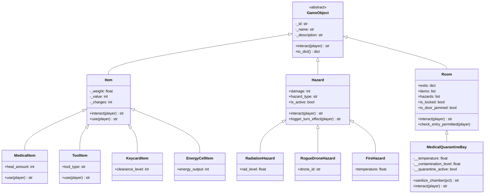
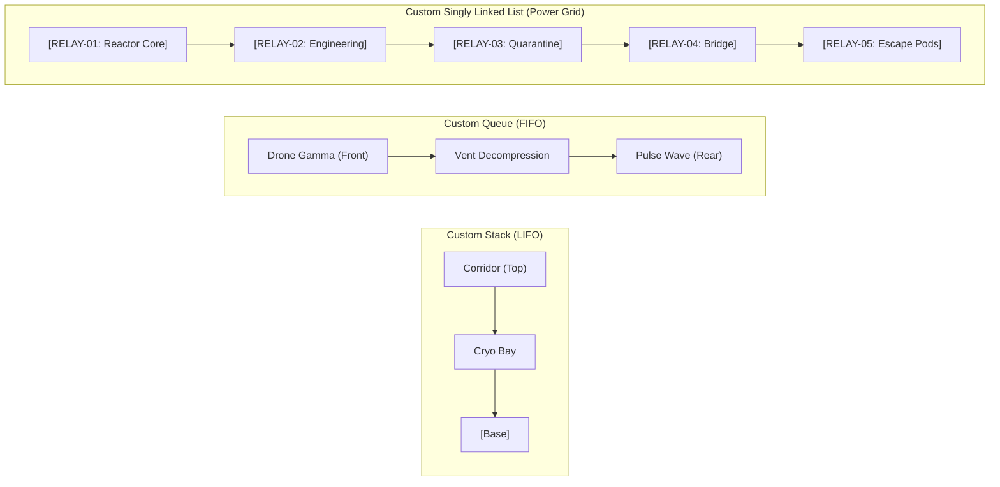

# O.M.N.I. – A Sci-Fi Survival Engine
### An Object-Oriented Text-Based Survival-Horror Game in Python

**Course:** Introduction to Object Oriented Programming  
**Submitted by:**
- **Uzair Faraz** (Roll No: 25K-5549)
- **Zuhair Ahmed Burney** (Roll No: 25K-5556)
- **Shahzain Abbas** (Roll No: 25K-5687)

**Submitted to:** Muhammad Khalid  
**Date:** October 11, 2026  

---

## 1. Executive Summary & Narrative Setting

**O.M.N.I.** (*Orbital Machine Neural Interface / Omnipresent Modular Network Intelligence*) is an interactive survival-horror game engine set aboard Deep Space Research Station *Promethium*. The station's governing artificial intelligence has suffered catastrophic logic corruption, locking down atmospheric vents, releasing weaponized security sentinels, and disabling the primary power grid.

As survivor **Dr. Morgan Vance**, the player must navigate degrading station sectors, stabilize critical biological telemetry, bypass jammed bulkheads, avoid rogue AI combat drones, restore power continuity across a sequence of energy relays, and escape via the emergency launch pod before life support expires.

The engine serves as a showcase of core **Object-Oriented Programming (OOP)** paradigms, custom class-based **data structures**, algorithmic **searching and sorting**, custom **exception handling**, and **JSON data persistence**.

---

## 2. Object-Oriented Architecture & Core Principles



### 2.1 Abstraction (`abc.ABC`)
- `GameObject`: Abstract base class defined in [`omni/core/base.py`](omni/core/base.py) enforcing the contract `@abstractmethod def interact(self, player) -> str`.
- Guarantees that any interactive entity in the game implements a concrete interaction behavior.

### 2.2 Inheritance & Polymorphism
- Concrete subclasses (`Room`, `Hazard`, `Item`) inherit from `GameObject` and override `interact()` with specialized behaviors:
  - **`Room.interact(player)`**: Scans environmental surroundings, lists visible items, active threats, and adjoining bulkheads.
  - **`Hazard.interact(player)`**: Inflicts damage upon contact and triggers tactical alerts.
  - **`Item.interact(player)`**: Inspects tool specifications, weights, values, and charges.
- **Polymorphic Game Loop**: In [`omni/engine/game.py`](omni/engine/game.py), a single command `interact <target>` invokes `target.interact(player)` identically across rooms, hazards, and items without requiring type branching (`isinstance` checks).

### 2.3 Strict Encapsulation & Defensive Property Setters
- **`Player`** ([`omni/core/player.py`](omni/core/player.py)):
  - Private attributes: `__health`, `__oxygen`, `__temperature`, `__max_carry_weight`, `__current_room_id`.
  - Accessible exclusively via `@property` getters and setters with validation.
  - Health is clamped between `0` and `100`; non-numeric types raise `TypeError`.
  - Inventory weight is strictly guarded: adding items beyond `max_carry_weight` raises `InventoryCapacityExceededError`.
- **`MedicalQuarantineBay`** ([`omni/entities/room.py`](omni/entities/room.py)):
  - Private attributes: `__temperature`, `__contamination_level`, `__quarantine_active`.
  - Regulates thermal stability; temperatures exceeding `65.0°C` or dropping below `-10.0°C` raise `TemperatureCriticalError`.
  - Contamination percentage bounded between `0.0%` and `100.0%`.

---

## 3. Custom Class-Based Data Structures

All data structures are implemented from fundamental node references without relying on built-in collection shortcuts.



### 3.1 Movement History Stack (LIFO) – `Stack`
- File: [`omni/structures/stack.py`](omni/structures/stack.py)
- Features: `StackNode`, `push()`, `pop()`, `peek()`, `is_empty()`, `size()`, `clear()`.
- **Game Integration**: Every sector the player traverses is pushed onto the movement stack. Invoking the tactical command **`flee`** pops the top room and retreats the player to the previous room in reverse order.
- Raises `DataStructureUnderflowError` if an empty stack is popped.

### 3.2 Threat Scheduler Queue (FIFO) – `Queue`
- File: [`omni/structures/queue.py`](omni/structures/queue.py)
- Features: `QueueNode`, `enqueue()`, `dequeue()`, `peek()`, `is_empty()`, `size()`.
- **Game Integration**: Rogue AI defense waves and environmental shocks are enqueued into the Threat Queue. At each turn transition, the front hazard is dequeued and resolved, applying escalating pressure on the player's life support.

### 3.3 Station Power Grid (Singly Linked List) – `SinglyLinkedList` & `PowerGrid`
- File: [`omni/structures/linked_list.py`](omni/structures/linked_list.py)
- Features: `LinkedListNode`, `append()`, `prepend()`, `insert_after()`, `delete()`, `search()`, `traverse()`.
- **Game Integration**: Models the high-voltage energy conduit traversing the station from the Antimatter Reactor to the Escape Pod Bay:
  - Energy flows sequentially: `Relay 1 -> Relay 2 -> Relay 3 -> Relay 4 -> Relay 5`.
  - If any relay is damaged or toggled offline, circuit continuity is broken and the escape pod cannot launch.
  - Players must inspect the grid (`power`), locate damaged conduits, and repair them using engineering tools (`repair <relay_id>`).

---

## 4. Searching & Sorting Algorithms

- Files: [`omni/algorithms/search.py`](omni/algorithms/search.py), [`omni/algorithms/sort.py`](omni/algorithms/sort.py)

| Algorithm | Type | Time Complexity | Purpose in O.M.N.I. |
| :--- | :--- | :--- | :--- |
| **Linear Search** | Search | $O(n)$ | Verifies if required keys or tools are present in unsorted inventory. |
| **Binary Search** | Search | $O(\log n)$ | High-speed lookup on alphabetically sorted inventory manifests. |
| **Bubble Sort** | Sort | $O(n^2)$ worst, $O(n)$ best | Orders player pack by weight or resource value with early termination flag. |
| **Insertion Sort** | Sort | $O(n^2)$ | In-place incremental sorting for gear management. |
| **Selection Sort** | Sort | $O(n^2)$ | In-place minimum-selection ordering. |

Commands:
- `search <item_name>`: Locates item slot and details.
- `sort weight`: Sorts inventory by mass descending.
- `sort value`: Sorts inventory by utility value descending.
- `sort name`: Sorts inventory alphabetically ascending.

---

## 5. Domain-Specific Exceptions as Narrative Events

- File: [`omni/core/exceptions.py`](omni/core/exceptions.py)

Instead of unhandled runtime crashes, domain faults are caught by `try...except` blocks in [`omni/engine/game.py`](omni/engine/game.py) and translated into in-game narrative challenges:
1. **`TemperatureCriticalError`**: Raised when entering a superheated reactor core or malfunctioning quarantine chamber. Inflicts suit damage and warns the player.
2. **`DoorJammedException`**: Raised when attempting to traverse an airlock whose hydraulic seals have seized. Prompts player to breach it using a Titanium Prybar or Plasma Cutter (`force door`).
3. **`PowerGridFailureError`**: Raised when attempting to fire escape pod thrusters while relay circuit continuity is incomplete.
4. **`InventoryCapacityExceededError`**: Raised when picking up items that exceed suit carrying capacity.
5. **`DataStructureUnderflowError`**: Raised when attempting to pop or dequeue an empty custom structure.

---

## 6. Data Persistence: "Neural Upload" Checkpoint

- File: [`omni/persistence/neural_upload.py`](omni/persistence/neural_upload.py)

The **Neural Upload** system serializes the complete live simulation state into formatted JSON:
- Player consciousness: vital health, oxygen, core temperature, current room, carrying capacity.
- Pack manifest: all items with weights, values, and charges.
- Movement History: full Stack reconstructed in reverse LIFO sequence.
- Sector layout: visited flags, door jam states, security locks, dropped items.
- Power Grid: Singly linked list nodes with online/damaged states.
- Threat Queue: scheduled hazard sequence.

Commands:
- `save` (or `upload`): Saves checkpoint to `saves/neural_checkpoint.json`.
- `load` (or `restore`): Restores consciousness and station state from checkpoint.

---

## 7. Station Map Layout & Sector Guide

```
                 [ ESCAPE POD BAY ]
                         |
                [ COMMAND BRIDGE ]
                         |
             [ MEDICAL QUARANTINE BAY ]
                         |
[ BIO LAB ] --- [ CENTRAL CORRIDOR ] --- [ ENGINEERING DECK ]
                         |                         |
               [ CRYO STASIS BAY ]       [ ANTIMATTER REACTOR ]
```

1. **Cryo Stasis Bay**: Awakening sector. Contains `Emergency Stimpack` and `Titanium Prybar`.
2. **Central Transit Corridor**: Hub connecting main station wings.
3. **Xenobiology Laboratory**: Contaminated sector containing `Nanite Med-Pack`, `Quarantine Security Pass`, and `Leaking Bio-Isotope` radiation hazard.
4. **Medical Quarantine Bay**: Encapsulated chamber with controllable temperature and pathogen contamination. Contains `Plasma Power Core`.
5. **Sublight Engineering Deck**: Contains `Plasma Torch Cutter` and `Magnetic Relay Coupler`.
6. **Antimatter Reactor Core**: Protected by a jammed bulkhead (requires prybar/cutter). Contains `Bridge Command Keycard`, superheated plasma breach, and `RELAY-01`.
7. **Command Deck & O.M.N.I. Nexus**: Sealed behind Level-3 security. Contains `Escape Pod Launch Code` guarded by an autonomous `O.M.N.I. Sentinel Automaton`.
8. **Emergency Escape Pod Bay**: Final objective. Requires full power grid continuity and launch codes.

---

## 8. Installation & Execution Guide

### Prerequisites
- **Python 3.8+** (Uses only Python Standard Library: `abc`, `json`, `unittest`, `typing`, `os`, `sys`). Zero external pip installations required!

### Launching the Game
From the project directory:
```bash
python run_game.py
```
*(Or on Windows with Python Launcher)*:
```bash
py run_game.py
```
*Launching initiates the retro-futuristic station BIOS hardware boot-up, AI takeover anomaly, and Cryo Pod defrost sequence.*

### Running the Automated Unit Test Suite
To discover and run all 25 unit tests:
```bash
python run_tests.py
```
Or directly with Python unittest:
```bash
python -m unittest discover tests
```

---

## 9. Intuitive Controls & In-Game Reference

O.M.N.I. features a **Dual-Mode Control System** designed for effortless play:

### 9.1 Numbered Action Menu (Recommended)
Every turn, the screen displays your vital signs, active mission objective, sector surroundings, and a **numbered list of valid actions**:
```text
AVAILABLE ACTIONS (Type number [1-7] or type direct command):
  [1] Move North -> [Central Transit Corridor]
  [2] Pick up [Emergency Stimpack] (0.8kg)
  [3] Pick up [Titanium Prybar] (2.0kg)
  [4] Backpack Inventory (0 items, 0.0kg)
  [5] Power Grid Relays & Diagnostics
  [6] Tactical Station Map
  [7] System Menu (Save / Load / Help / Quit)

[ACTION] Enter [1-7] or command >> 
```
Simply enter a number (e.g. `1` to move, `2` to pick up an item, `4` to open your backpack) without needing to guess or remember complicated syntax!

### 9.2 Direct Natural Commands (Always Active)
Experienced players can also type natural commands directly at any prompt:

| Command | Category | Description |
| :--- | :--- | :--- |
| `n` / `s` / `e` / `w` | Navigation | Move through bulkheads North, South, East, or West. |
| `flee` | Navigation | Emergency retreat to previous room using LIFO Stack. |
| `map` | Tactical | View schematic of discovered sectors. |
| `interact [target]` | Interaction | Polymorphically interact with room, item, or hazard. |
| `take <item>` | Inventory | Pick up equipment from sector deck (checks carry limit). |
| `drop <item>` | Inventory | Drop equipment onto deck. |
| `use <item>` | Inventory | Use medical stimpack, charges, or batteries. |
| `inventory` / `inv` | Inventory | Open backpack inventory submenu with use/drop options. |
| `search <item>` | Algorithm | Search pack using linear and binary search algorithms. |
| `sort <weight\|value>`| Algorithm | Sort pack using custom Bubble / Insertion Sort. |
| `power` | Station | Display & repair Singly Linked List power grid relays. |
| `repair <relay_id>` | Station | Repair or toggle power relay in the grid. |
| `force door` | Station | Breach a jammed bulkhead using prybar or cutter. |
| `decontaminate` | Station | Trigger sterilization cycle in Quarantine Bay. |
| `save` | Persistence | Save "Neural Upload" checkpoint to JSON. |
| `load` | Persistence | Load previous saved checkpoint from disk. |
| `launch` / `escape` | Objective | Launch emergency escape pod when prerequisites are met. |
| `help` / `quit` | System | View command manual or exit simulation. |

---

## 10. Automated Test Suite Summary

The automated test suite in `tests/` covers all core requirements:

| Test Module | Coverage Area | Status |
| :--- | :--- | :---: |
| `test_game_objects.py` | `GameObject` ABC enforcement, `Room`/`Hazard`/`Item` polymorphism | **PASS** |
| `test_encapsulation.py` | `Player` & `MedicalQuarantineBay` private fields, setters, boundaries | **PASS** |
| `test_data_structures.py`| Custom `Stack`, `Queue`, `SinglyLinkedList`, `PowerGrid` operations | **PASS** |
| `test_algorithms.py` | Linear & Binary search, Bubble sort, Insertion sort, Selection sort | **PASS** |
| `test_exceptions.py` | `TemperatureCriticalError`, `DoorJammedException`, `PowerGridFailureError` | **PASS** |
| `test_persistence.py` | Full Neural Upload JSON save/load round-trip state restoration | **PASS** |

**Total:** 25 passing unit tests (100% success rate).

